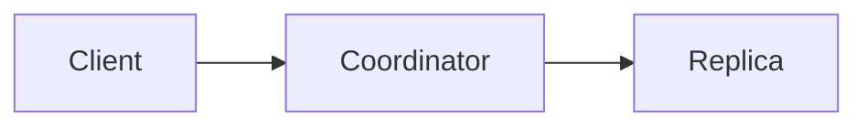

# OpenRiak documentation site

This repository produces one static OpenRiak website from two independently
cacheable Hugo 0.166.0 projects.

- The **core** project contains the homepage, Community, and versioned product documentation.
- The **archives** project contains the immutable Archived Technical Blog and Archived Mailing List.
- An assembly step combines both outputs into `public/` for rsync deployment.

Shared layouts, navigation data, and assets remain under `layouts/` and
`content/static/`. The core build is the only owner of shared static output;
the archive build may emit files only below its two archive URL directories.

GitHub-style Markdown alerts are supported by the vendored admonition module in
both Hugo projects and in every build profile:

```markdown
> [!NOTE]
> Tagged releases contain a `rebar.lock` file.
```

Product docs also support `> [!DOCKER] Docker`. The local render hook at
`layouts/docs-theme/layouts/_markup/render-blockquote-alert.html` is explicitly
mounted in `content/hugo.yaml`; it adds the Docker type to the vendored module.
Its icon lives in `layouts/docs-theme/layouts/partials/admonitions/icons/docker.svg`,
and its colors are defined by `.admonition.docker` in `layouts/docs-theme/static/css/docs.css`.

Product documentation can insert the version being browsed with the text-only
`` shortcode. It can be used as ordinary text, inside
inline code, or inside a fenced code block. Use
`` when only the major and minor
components are needed. For example:

````markdown
Version 

Release line 

`riak-`

```text
riak-
```
````

Search links highlight matching code after the code controls initialize and
reveal the first matching language tab without changing the saved preference.
With Playwright installed and the preview running, verify this with
`node tools/scripts/search-highlight.browser.test.cjs`. Optional
`OPENRIAK_BROWSER_EXECUTABLE` and `OPENRIAK_SEARCH_TEST_BASE` select the browser
binary and the URL of the OpenRiak KV 3.4.0 documentation root.

Run `node tools/scripts/os-history.browser.test.cjs` with Playwright installed to
verify that browser Back and Forward refresh the saved OS and architecture,
including download panels and OS-specific values. This test starts its own local
fixture server and enables the browser's back/forward cache. Set
`OPENRIAK_BROWSER_EXECUTABLE` to use a specific Chromium binary.

Consecutive fenced code blocks with different language labels become language
tabs in product documentation. Text between blocks, unlabelled blocks, and
repeated languages end a tab group. The selected language is remembered in the
browser and selected in other groups where available. Code controls remain
available for each example; printing or disabling JavaScript shows every block.

## Mermaid diagrams

Mermaid fences render to inline SVG at build time using locally vendored
[Pele](https://github.com/obsidianmd/pele) 1.9.0. For example:

````markdown

````

The build preparation step runs `node tools/scripts/render-mermaid.mjs` before
Hugo. It parses Markdown fences with Marked, renders each distinct diagram once,
and writes SVG assets under `tools/generated/mermaid/`. Hugo embeds those SVGs;
no diagram JavaScript is shipped to readers. Diagrams follow the site theme and
remain visible with JavaScript disabled. Source is available in a disclosure.
Use literal Mermaid text inside fences; Hugo shortcodes are not supported there.
Invalid diagrams fail preparation with the source filename. Direct Hugo commands
must run preparation first. Docker preview also watches Markdown for changes.

Draft examples are under `openriak-kv/3.4.0/to-do/tests/mermaid/` and inherited by
later releases. Run `node --test tools/scripts/render-mermaid.test.mjs` and
`node tools/scripts/mermaid.browser.test.cjs` (with Playwright and preview running)
to verify generation and rendering.

Pinned ESM bundles and licenses live under `tools/scripts/vendor/pele/` and
`tools/scripts/vendor/marked/`. Their README files record provenance and hashes.
No npm install is needed to build the docs.

## Repository layout

- `content/` — authored content, the core `hugo.yaml`, and `hugo-archives.yaml`.
- `docker/` — split local preview and cacheable production builds.
- `layouts/` — shared and section-specific templates.
- `notes/` — architecture notes and retained migration or validation reports.
- `public/` — the assembled static output.
- `tools/` — build, validation, assembly, and metadata adapters.

## Content and metadata

CLI and settings annotations are maintained in [content/annotations/openriak-kv/](content/annotations/openriak-kv/README.md). They add descriptions, categorized tags and version-specific corrections over the release metadata. Run `node tools/scripts/watch-cli-reference.js --once` to regenerate CLI/settings data and their completeness/review reports. Setting names and default values remain authoritative from metadata; datatype corrections produce non-failing Hugo warnings.


Production KV Markdown uses flat version directories in two source families:

- `content/riak-kv/{version}/` contains historical Riak KV versions from 2.0.0 up to, but not including, 3.4.0.
- `content/openriak-kv/{version}/` contains OpenRiak KV versions beginning at 3.4.0.
- Earlier versions in the same source family are inherited automatically; inheritance never crosses the 3.4.0 boundary.

Release metadata under `content/openriak-kv/metadata/{version}/` is authoritative
for supported operating systems, package downloads, and replaceable configuration
values. Build tools generate browser/Hugo adapters under `tools/generated/` and
never write under `content/`.

Generate and deploy release metadata from the separate
[openriak-metadata repository](https://github.com/TI-Tokyo/openriak-metadata).
Its `deploy --docs-root ../openriak-docs` command updates the authoritative JSON;
the docs build does not require the generator to be installed.

Hugo publishes browser metadata as shared JSON helpers under
`metadata/{content-sha256}.json`. Pages link to these files instead of embedding
the metadata in their HTML. The version picker shares a compact product index,
and pages of the same version share its OS and configuration values. Package
and Docker/CVE records are used only by the download tables that render them.
Configuration-reference defaults and raw code also use shared helpers; the
Markdown copy helper loads only when requested. Identical content reuses the
same URL and browser cache, while changed content automatically gets a new URL.
Deploy the generated `metadata/` directory alongside the HTML and other assets.

Run `node tools/scripts/metadata-loader.test.js` to check helper caching and
failure handling.

## Build profiles

The same source tree supports three explicit profiles:

- `development` builds only core, with one historical Riak KV release and the latest CS and TS releases. Riak KV defaults to `3.2.5`; set `OPENRIAK_DOCS_RIAK_KV_VERSION` to work on another imported release.
- `beta-test` builds only core, with every Riak KV and OpenRiak product release mounted.
- `release` builds all core releases and both archive projects, then assembles one deployment tree.

Docker static builds are selected by the first argument:

```sh
./docker/build.static.sh development
./docker/build.static.sh beta-test
./docker/build.static.sh release
```

All three write their selected artifact to `public/`. The release artifact is the
only one intended for rsync deployment.

## Release build

The Docker build caches the immutable archives independently from active content:

```sh
./docker/build.static.sh release
```

This writes the complete assembled site to `public/`. Product-only changes reuse
the archive image layer. A change to shared or archive templates correctly
invalidates the archive layer.

With local Hugo 0.166.0 and Node.js installed, the equivalent uncached build is:

```sh
HUGO_BASEURL=https://www.openriak.org/docs/ INCLUDE_DRAFTS=true ./tools/scripts/build.sh release
```

PowerShell users can run `tools/scripts/build.ps1`. Both entrypoints build the two
projects and assemble the same `public/` layout.

## Local preview

```sh
./docker/run.local.sh development
```

The launcher recreates preview containers on each invocation, retaining their
named Hugo cache volumes. This renews Docker Desktop bind mounts if you deleted
`build/` or `build/archives` between runs; the archive directory is recreated
automatically. Cleaning `public/` does not affect this preview.

Use `./docker/run.local.sh beta-test` to preview all core releases, or
`./docker/run.local.sh release` to run core and archives together. The gateway
always listens at `http://localhost:1410/docs/`. In development and beta-test,
archive URLs use the last successful cached archive output when one exists; no
archive Hugo process is started.

## Runtime container

Build the production Nginx image with:

```sh
docker build -f docker/Dockerfile --build-arg HUGO_BASEURL=https://www.openriak.org/docs/ -t openriak-docs .
```

The image contains the same assembled static site below `/docs/`. Public servers
do not require Hugo, Node.js, or multiple containers.

### Downloads page shortcodes

OpenRiak KV Downloads pages control their section order in Markdown:

```markdown
## Recommended Downloads






Source-code documentation goes here, including Markdown and other shortcodes.









```

The package and Docker recommendations follow the shared OS selection. Each
shortcode works independently of the all-download lists. Docker tables use only
published, passed cache data; displaying them does not run Docker tests.
Disclosures start collapsed; `title` sets the summary and optional `id` provides
an anchor. Optional `level="2"` renders the title as an `h2` (equivalent to `##`)
and includes it in “On this page”; levels 1 through 6 are supported and nested
accordingly. Without `level`, the title is not included in the table of contents.
These shortcodes use the version being viewed, including inherited pages.

## Browser settings and personalized examples

The Settings entry at the bottom of the Site sections menu opens `/settings/`, an overview linking to separate Appearance,
Code blocks, OS and architecture, Tables and filters, Example values, and
Import/export pages. The shared left sidebar searches controls across those pages. The landing page
also offers Clear all, with confirmation before resetting preferences, example
values, and saved filters.
Changes use the existing preference keys, so earlier browser choices carry over.
Code options are edited in a sortable, column-filterable table (initially Type,
descending). Inapplicable cells have no control; Command Split is available only
for Bash, Sh, and Shell. Type rows inherit
DEFAULT values unless overridden; DEFAULT also sets global output expansion.
Only one type can be preferred. Set to Default clears that row's overrides and
preferred selection; Set All to Default clears all type overrides and the preferred
selection while keeping the DEFAULT values. Maintainers define available types in
`layouts/common-docs/data/settings_code_types.json`; readers cannot add types.
The output expand/collapse buttons apply globally and clear output overrides.

Platform settings list OpenRiak KV, CS, and TS with their project logos. Each
project has a preferred documentation version, defaulting to Latest. Homepage
project links follow that preference, with an additional Open Latest link when
a specific version is selected. OS and architecture controls share the
picker implementation used by the selected version's documentation and expose
only that version's supported choices. Versions without an OS picker say so.
Desktop forms align their fields after the longest label; mobile forms stack.
Import, Export, and Reset have separate headings.

Settings exports use versioned JSON (`format: openriak-docs-settings`, `version: 1`).
Import validates the complete file before writing and previews changes. Merge
preserves omitted preferences; Replace resets them. Exports can include all
preferences or one group. Votes, scroll positions, and the local filter-control
catalog are excluded. Table controls become available in Settings after a visit
to the corresponding table; configuration filters are scoped by product, page,
and table index, while review filters retain their existing product scope.

Authors can insert browser-local example values with the `example` shortcode.
Indices start at one; omitted fields select `name`:

```text





```

Groups are `cluster`, `node`, `backend`, `listener`, `sink`, `domain`, and `user`.
Their editable fields are defined in `settings-store.js`; build-time fallback
values live in `layouts/common-docs/data/example_values.json`. Cluster and node
names use `{index}` or `{letter}` patterns unless an explicit name is supplied.
Example values do not modify authoritative configuration-reference defaults.
Shortcodes work in prose, inline code, and fenced blocks. Code copy/download uses
the personalized text. Without JavaScript, the default values remain readable.
Fences containing shortcodes retain their resolved source in an HTML template
because Hugo expands shortcodes after the code render hook runs.

The draft page `openriak-kv/3.4.0/to-do/tests/example-values/` demonstrates these
contexts. With the development preview and Playwright available, run:

```sh
node tools/scripts/settings.browser.test.cjs
```

`OPENRIAK_SETTINGS_TEST_BASE` overrides the preview root (default
`http://127.0.0.1:1410/docs/`), and `OPENRIAK_BROWSER_EXECUTABLE` selects Chromium.
