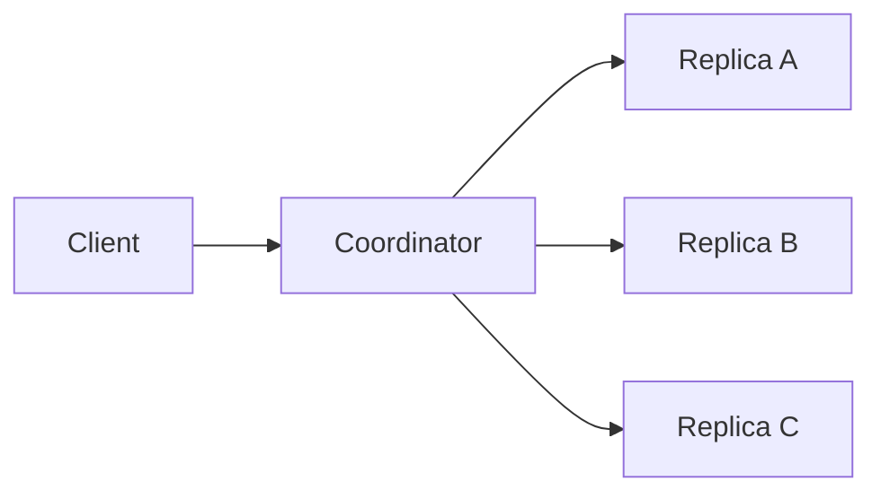
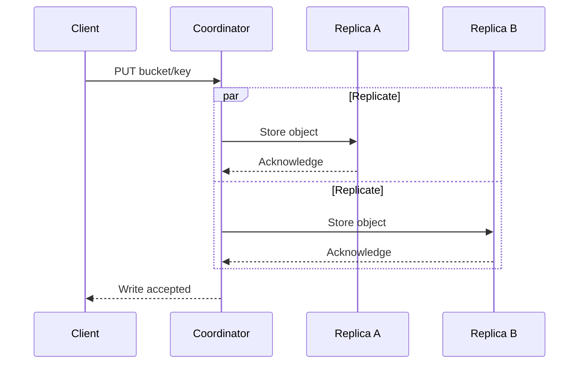
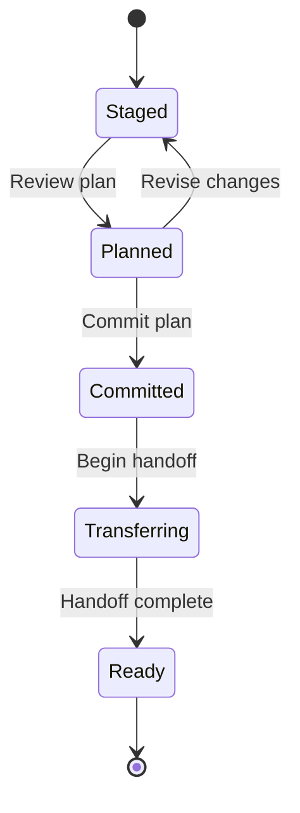
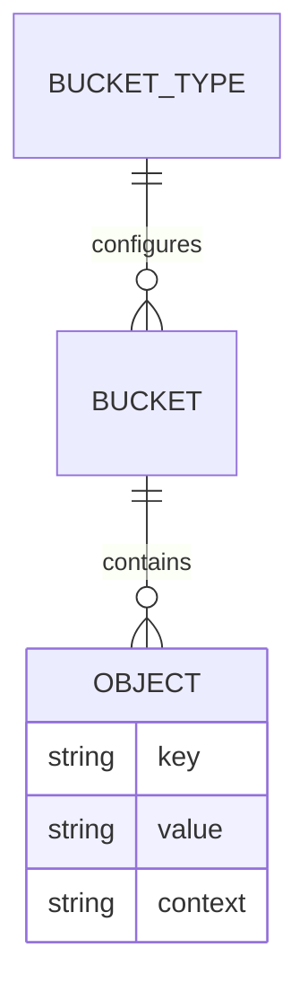

Use a fenced code block labelled `mermaid` to render an SVG diagram with
[Pele](https://github.com/obsidianmd/pele). Open **Mermaid source** beneath a
diagram to see its input. These simplified examples illustrate diagram syntax,
rather than specifying protocol behavior.

Check these examples in light and dark themes and at a narrow window width.
The SVGs are generated during the build and remain visible with JavaScript disabled.

## Flowchart: replicated write

## Sequence: quorum response

## State diagram: membership planning

## Entity relationship: stored objects

